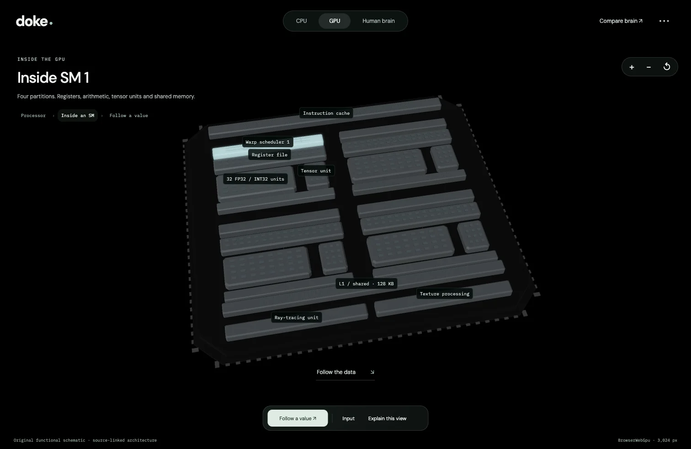

# doke

Look inside CPUs, GPUs, a tensor processor, a network ASIC and the human brain. A floating 3D explorer with source-linked architecture, close-up execution, and an input you can change.

Start with the whole processor, open a core or streaming multiprocessor, then follow one value through actual operand reads and arithmetic. Choose Ryzen 9 9950X, RTX 5090, H100 SXM, Google TPU v1 or Cisco Silicon One G200 from one hardware selector. These are original functional schematics, not physical die floorplans.

The Rust models compute editable matrix transforms or route packets through queues. Inspect returned operands, cache residency, requested GPU sectors and each completed product. Model ticks are authored teaching time, not vendor cycles or chip benchmarks. The human reference atlas remains available on its own or alongside the chip, with sourced anatomy and a visual-processing guide. A shared logarithmic time scale compares documented chip clock periods with human physiological measurements; their conditions and limits are one click away.



## Run locally

See the [setup guide](docs/GUIDE.md#build-and-run) for first-time dependencies and anatomy generation. After setup:

```sh
bash tools/build.sh
python3 tools/serve.py
```

Open [localhost:4173](http://localhost:4173). Everything runs in the browser; hosting only serves static files.

- [Guide](docs/GUIDE.md): controls, builds, verification and hosting.
- [Architecture and model scope](docs/SILICON.md): sources, what is calculated, and next steps.

## Repository

| Path               | Purpose                                                           |
| ------------------ | ----------------------------------------------------------------- |
| `crates/doke-core` | Deterministic execution models and bounded snapshots              |
| `crates/doke-web`  | Rust/Wasm rendering, geometry, camera and HDR                     |
| `public`           | Interface, source records, anatomy metadata and runtime assets    |
| `tools`            | Reproducible anatomy generation, validation, builds and packaging |
| `tests`            | Source, geometry, execution, browser and static-hosting checks    |

Generated Wasm, anatomy binaries, downloads, packaged builds, raw screenshots and local deployment settings are ignored. Retain the [atlas notice](public/assets/NOTICE.md), font licenses and dependency notices when distributing the app. A license for doke's original source has not yet been selected; third-party materials retain their respective licenses.
