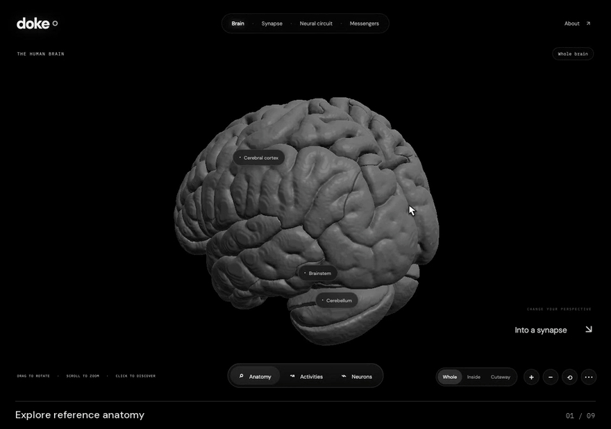

# doke

A floating, interactive brain explorer built with Rust, WebAssembly and wgpu. Explore reference anatomy, an enlarged neural tissue window, chemical synapses, a neural circuit and molecular messengers. Mostly grayscale, with restrained color accents and adaptive HDR.



*A 24-second tour of the real app, captured with SDR glow. [Recording instructions](docs/GUIDE.md#recording-a-demo).*

## Run locally

Follow the [first-time setup](docs/GUIDE.md#building-from-a-fresh-clone) to install the tools and generate the anatomy assets. Then:

```sh
bash tools/build.sh
python3 tools/serve.py
```

Open [localhost:4173](http://localhost:4173). Rendering and simulation run in the browser; the server serves static files.

The [doke guide](docs/GUIDE.md) covers controls, scientific interpretation, builds, verification and hosting. It is the single maintained project guide.

## What is calculated

Brain geometry derives from the Allen Human Reference Atlas; molecule coordinates come from PubChem. Activity highlights, enlarged neurons, synaptic contacts and traveling particles illustrate supported concepts. They are not reconstructed individual cells or measured firing/chemical concentrations. The simplified neural circuit integrates population dynamics in Rust. Source records and scientific limitations are available in the interface.

## Source map

| Directory          | Purpose                                              |
| ------------------ | ---------------------------------------------------- |
| `crates/doke-core` | Activity envelopes and numerical E/I model           |
| `crates/doke-web`  | Rust rendering, camera, procedural cells, shaders    |
| `public`           | Floating interface, source records, runtime assets   |
| `tools`            | Asset generation, validation, builds and deployment  |
| `tests`            | Browser, playback, HDR, fallbacks and hosting checks |
| `docs/GUIDE.md`    | Usage, development and publishing guide              |

## Repository contents and attribution

Generated Wasm, anatomy binaries, downloaded source data, packaged builds, test screenshots, historical working notes and private deployment settings are excluded from Git. Keep the required fallback image, local fonts, source metadata and third-party notices: they are part of the application.

Atlas attribution is in [the asset notice](public/assets/NOTICE.md), font licenses in `public/fonts/`, and Rust dependency notices in `public/licenses/`. A license for doke's original source code has not been selected; third-party licenses apply to their respective material.
