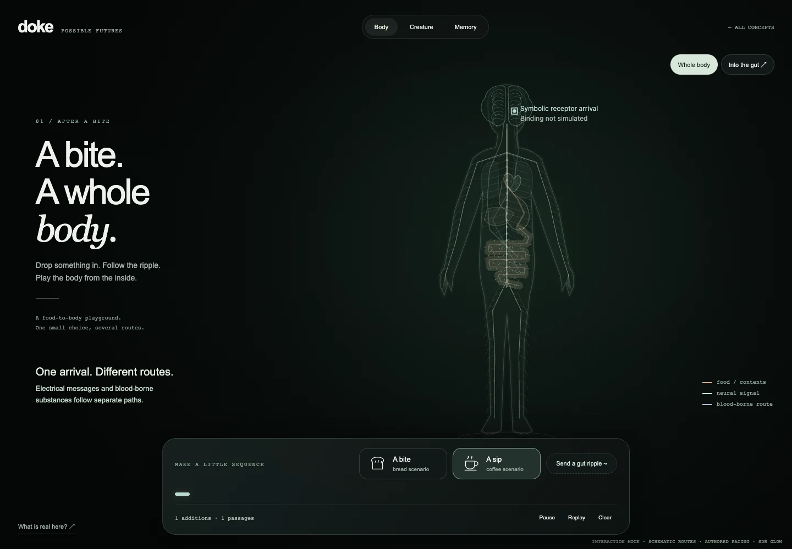
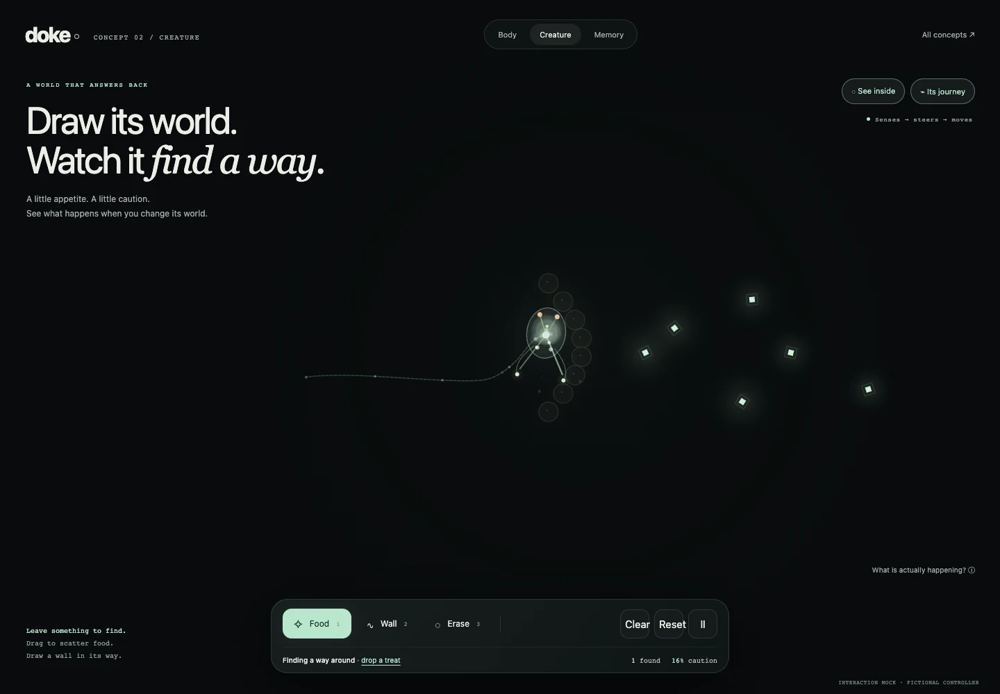
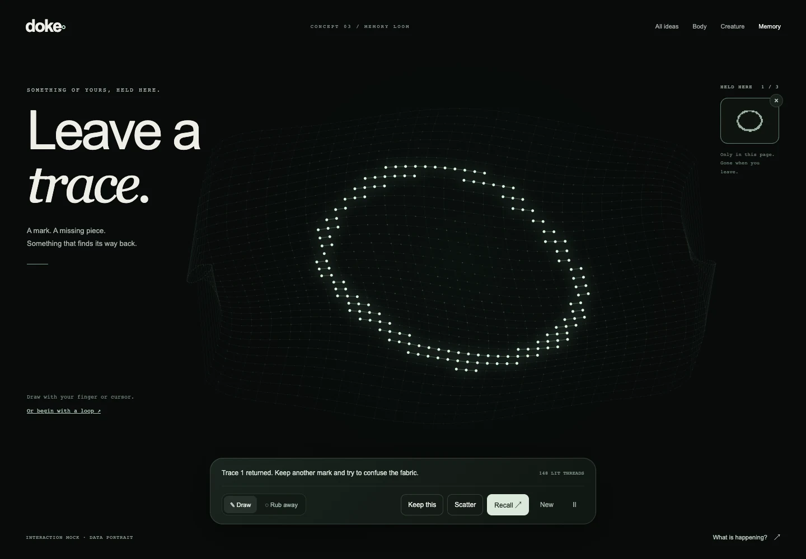

# What if doke were something you could play?

**Design research · 14 October 2026 · no production direction approved.** This replaces the lesson-first proposal in PRs [#1](https://github.com/ishaansathaye/doke/pull/1) and [#2](https://github.com/ishaansathaye/doke/pull/2), which remain unmerged. This branch starts from the original `main` baseline. The existing website is unchanged.

## Start with the mocks

```sh
python3 -m http.server 4180 --bind 127.0.0.1 --directory docs/play/mocks
```

Open **[the concept gallery](http://127.0.0.1:4180/)**. These are working interaction sketches, not screenshots pretending to be interactive, and not implementations of complete biological models. They need no Rust build, downloaded anatomy, account, microphone or network service. They also open directly as local HTML files. Motion and glow are SDR; production HDR is not being replaced or evaluated here.

| Mock                                   | Make something                                            | Change it                                                               | What actually runs                                                                                                                                 |
| -------------------------------------- | --------------------------------------------------------- | ----------------------------------------------------------------------- | -------------------------------------------------------------------------------------------------------------------------------------------------- |
| [After a Bite](mocks/body.html)        | A sequence of food/drink scenarios inside a floating body | Add a local gut wave; follow the enlarged gut; replay                   | Bounded toy bolus transport, wave impulses, separate authored neural/blood routes and a retained sequence. Not nutrition or whole-body physiology. |
| [Little Stranger](mocks/creature.html) | A habitat with food and barriers                          | Block a route, erase/repaint a food patch, inspect its transparent body | A reactive sensor–motor controller, collisions, and bounded contact-dependent avoidance. Not synaptic learning or a real animal.                   |
| [Memory Loom](mocks/echo.html)         | Your own mark on a luminous fabric                        | Keep several, rub away a fragment, ask it to return                     | Masked nearest-template retrieval with ambiguous/no-match outcomes. Not a neural network or a model of human memory.                               |





The previews are real captures of the mocks. Only these three compact images are retained; raw screenshots and test output are ignored. The gallery is the easiest way to compare the experiences.

## Why the previous direction missed

The timing experiment asked someone to operate a preparation whose topology, protocol and expected result were already chosen. Its reward was understanding a fact. Better shaders would not change that premise.

[Phloem](https://github.com/thcp/phloem) begins with a repository the visitor recognizes. Its history produces an accumulating physical-looking artifact: inputs have identity, the past remains visible, and the next event changes the object. Our design inference is that **ownership, consequence and surprise** are the useful ingredients. A neural graph with more activity is not enough.

The new first action should be “make a world,” “leave a mark,” or “drop something in.” There should be something worth watching before opening an explanation. Sources explain the surprise afterward. A game does not require leaderboards: authorship, discovery, disruption, recovery and attachment can provide the reward.

## The idea set

These are original design proposals, not outcomes established by the cited projects. Ratings and recommendations are judgments to test with people.

| Direction           | Input → transformation                                                                              | Reason to return                                                       | Main weakness                                                                             |
| ------------------- | --------------------------------------------------------------------------------------------------- | ---------------------------------------------------------------------- | ----------------------------------------------------------------------------------------- |
| **Little Stranger** | Draw a habitat → an embodied nervous-system toy senses, moves and changes its response to obstacles | Make it a home, surprise it, compare two histories                     | A creature can feel aimless; “learning” is easy to fake with scripted behavior            |
| **Memory Loom**     | Draw personal marks → partial cues choose among retained patterns                                   | Test what survives, mix memories, discover interference                | A restore button is not interesting unless the cue genuinely matters                      |
| **After a Bite**    | Compose foods/events → routes unfold through gut, nerves and circulation                            | Remix the sequence, ride different signals, play with local mechanics  | Most likely to become another animated infographic; highest biological-content burden     |
| **Echo**            | Drop a short local sound → recurring motifs leave a persistent acoustic sculpture                   | A fragment reawakens an earlier motif; unfamiliar input reorganizes it | Audio permissions/codecs and robust matching; loudness-to-glow alone is just a visualizer |
| **Your Tempo**      | Tap a rhythm → repetition and variation shape a living fabric                                       | Hear/replay your actual rhythm; make a different signature             | A pretty screensaver unless history affects subsequent behavior                           |
| **Borrowed Eyes**   | Bring a local image → move a virtual gaze through an adapting sensory field                         | Hide/reveal features; discover afterimages through your own picture    | A filter gallery unless adaptation and an observer task have consequences                 |
| **A Day in Tides**  | Arrange a few daily events → overlapping generic body rhythms shift                                 | Compare two compositions and inspect their different clocks            | Risks looking like a personal health forecast; less intrinsically playful                 |
| **Project Memory**  | Bring sanitized change events → recurring motifs organize a memory surface                          | Test recall and surprise rather than replay a file tree                | Closest to Phloem, weakest originality case, developer-specific audience                  |

No option needs a health, intelligence, productivity, happiness or “better brain” score. Challenges should concern the fictional system: a passage found, a pattern recovered, a composition created. If shared challenges eventually prove useful, they need versioned models and replay verification before accounts or rankings.

## Three concrete experiences

### Little Stranger — strongest game direction

**Hook:** “Draw its world. Watch it find a way.” Food and barriers are direct tools. A translucent organism gives its internal activity an external consequence: turning, contact, movement, exploration. The world and the trail belong to the visitor's choices. A naive twin or an optional sensor interruption could later reveal causality without a worksheet.

The mock computes a small closed loop: sensors sample the environment, their values control steering, movement changes the next sample, and contact changes a bounded avoidance gain. The body follows its path. Its internal moving light encodes continuous control; it is not computed action-potential firing. It has no place memory, synaptic plasticity, evolving genome or realistic biomechanics.

**First production slice, if selected:** one room, one original fictional organism, deterministic replay, a satisfying collision/escape response, and a causal inside view. Add one genuine adaptive mechanism only when its changed behavior is noticeable. Keep lifetime adaptation distinct from breeding/evolution. A full connectome would not by itself make this more faithful or more fun.

**Failure gate:** if people mostly wait for it, or cannot tell that their drawn world matters, change the control loop before adding anatomy. The desired moment is “I want to see what it does if I put this here.”

### Memory Loom — strongest compact ownership experiment

**Hook:** “Leave a trace.” A visitor draws something recognizable. It becomes a held mark in a floating material. Removing part of it and seeing a fragment retrieve the right mark creates a personal moment: _that is mine, coming back_.

The mock holds up to three patterns and compares only observed cells; erased cells are unknown. Retrieval can refuse an empty, weak or ambiguous cue. The reconstruction is a visual transition to a selected stored template. Calling this Hopfield learning would be false. A later recurrent associative model could introduce genuine dynamical settling, interference and capacity limits; [Hopfield's original paper](https://pmc.ncbi.nlm.nih.gov/articles/PMC346238/) supplies a possible model family, not a claim that drawings reproduce human memories.

**First production slice, if selected:** preserve drawing and partial-cue play, replace retrieval with a declared bounded model, make its failures legible, and compare computed states against the current template baseline. Keep imports local and optional. This is the smallest route to testing the “my input becomes a living thing” feeling without a food/health interpretation.

**Failure gate:** if Recall always succeeds or simply restores the most recently saved image, it is a magic undo button. People should be able to fool it and notice why a different cue changes its choice.

### After a Bite — closest to the brain–body ambition

**Hook:** “A bite. A whole body.” Food is a familiar entry point. The body is a traversable stage, with local gut motion, neural messages and blood-borne substances represented differently. A future version could follow a route into a local interaction. The current mock offers whole-body and gut close-up views.

The mock offers two authored scenarios, a retained sequence, local wave impulses and a gut close-up. The food position responds to a toy transport rule; the routes and their timing are illustrative. Bread is not a glucose dose; coffee is not an energy bonus. There is no nutrient database, absorption model, endocrine feedback, personal metabolism or food-to-neurotransmitter lookup. This mock is deliberately the most speculative of the three: it tests spatial appeal and input feel, not scientific simulation accuracy or whether the loop sustains play.

**Better production mechanic than a meal animation:** a reduced gut segment where soft contents and local contraction/relaxation interact. Let the visitor reposition a virtual bolus, create a wave, release a bottleneck and discover that the local system can coordinate without routing every instruction through the brain. The broader physiology is supported by [NIDDK](https://www.niddk.nih.gov/health-information/digestive-diseases/digestive-system-how-it-works); a specific isolated-mouse-colon study describes coordinated excitation/inhibition during propulsion ([Spencer et al., 2021](https://pubmed.ncbi.nlm.nih.gov/34376798/)). The toy mechanics still require their own declared equations and validation.

The first scope is one gut interaction plus one neural and one systemic route. Extend later into a body playground only if the manipulation itself is enjoyable. A fully simulated person is not a credible MVP.

**Failure gate:** if the experience is “choose a food, watch a movie, read a fact,” it repeats the rejected direction. Food icons are not sufficient personalization; composing, interrupting and changing a persistent system must matter.

## Where the inspiration is useful

We inspected primary project pages, papers, repositories and official documentation. Phloem's featured viewer and the live Growing NCA article were visually inspected; other entries below are source/documentation reviews, not claims that we independently ran or reproduced their research. No external code, artwork, trained weights or audio is included in the mocks.

| Reference                                                                                                                                                             | Transferable experience principle                                                                       | What to avoid copying or overclaiming                                                                                       |
| --------------------------------------------------------------------------------------------------------------------------------------------------------------------- | ------------------------------------------------------------------------------------------------------- | --------------------------------------------------------------------------------------------------------------------------- |
| [Phloem](https://github.com/thcp/phloem), [inspected architecture](https://github.com/thcp/phloem/blob/706d74bc049c9f12f75b546eec53ceebaa72ef91/docs/ARCHITECTURE.md) | Personally owned history changes a persistent object; cinematic follow can yield to direct manipulation | Its repository-to-vein mapping, code, assets or music. AGPL code and separate audio rights are not a blanket asset license. |
| [NeuroMechFly outreach game](https://neuromechfly.org/outreach/), [FlyGym](https://github.com/NeLy-EPFL/flygym)                                                       | Body movement makes control levels tangible; a genuine browser game uses MuJoCo/Wasm                    | Treating its scientific fly as a drop-in human nervous system, or importing the entire research stack just for spectacle    |
| [Keiwan's Evolution](https://keiwan.itch.io/evolution), [Karl Sims](https://www.karlsims.com/evolved-virtual-creatures.html)                                          | A body authored by the visitor can discover surprising strategies                                       | Calling population evolution within-animal learning; copying creature designs or assuming source availability grants reuse  |
| [Growing Neural Cellular Automata](https://distill.pub/2020/growing-ca/)                                                                                              | Direct damage and recovery make a hidden update rule visible through action                             | Presenting learned artificial self-repair as a biological regeneration model; copying the gecko/emoji demonstration         |
| [Particle Lenia](https://google-research.github.io/self-organising-systems/particle-lenia/), [Lenia](https://arxiv.org/abs/1812.05433)                                | Local interactions can create persistent, life-like objects that invite disturbance and discovery       | A giant parameter panel as the first screen; calling any decorative movement emergence                                      |
| [Simbrain Odor World](https://docs.simbrain.net/docs/worlds/odorworld.html)                                                                                           | Sensors and effectors connect the controller to a world the user can change                             | Confusing scripted pursuit with a learned controller                                                                        |
| [Sandspiel](https://sandspiel.club/), [source](https://github.com/MaxBittker/sandspiel)                                                                               | Painting changes persistent simulated material; Rust/Wasm is a practical browser precedent              | Reusing its elements or calling a game rule validated chemistry                                                             |
| [Chrome Music Lab](https://musiclab.chromeexperiments.com/), [Dear Data](https://www.dear-data.com/theproject)                                                        | Low-friction making and recognizable personal traces can be rewarding without scores                    | Treating audio features or an artistic encoding as a measurement of someone's brain                                         |

## Food, chemistry and the whole-body boundary

Connecting the brain to the body is a good spatial direction. Combining every mechanism into a single confident meal response would be misleading. Keep these routes distinct:

| Mechanism / source                                                                                                                                 | Supported observation                                                                                                        | Design consequence                                                                                                                                                        |
| -------------------------------------------------------------------------------------------------------------------------------------------------- | ---------------------------------------------------------------------------------------------------------------------------- | ------------------------------------------------------------------------------------------------------------------------------------------------------------------------- |
| [NIDCD flavor overview](https://www.nidcd.nih.gov/health/taste-disorders)                                                                          | Flavor combines taste, aroma, texture, temperature and chemical sensations                                                   | A sensory remix could be played before swallowing. Do not use the obsolete separated “tongue map.”                                                                        |
| [Kaelberer et al., 2018](https://pubmed.ncbi.nlm.nih.gov/30237325/)                                                                                | In the studied mouse system, intestinal nutrient-sensing cells communicate with vagal neurons through glutamatergic synapses | Neural signals carry information; the food or neurotransmitter is not traveling up the axon. Local millisecond transduction begins after access to the intestinal sensor. |
| [Tan et al., 2020](https://www.nature.com/articles/s41586-020-2199-7), [Buchanan et al., 2022](https://www.nature.com/articles/s41593-021-00982-7) | Specific gut sugar/sweetener pathways and mouse preference mechanisms differ from sweet taste alone                          | A later “same first impression, different route” puzzle is plausible. Sweeteners are not universally signal-free; this is not a human craving prediction.                 |
| [Nauck et al., 1986](https://pubmed.ncbi.nlm.nih.gov/3514343/)                                                                                     | Human oral/IV glucose comparisons with matched glycemia reveal an additional insulin response associated with the gut route  | Endocrine messaging is a separate mechanism. A route-comparison puzzle is possible; a personalized insulin calculator is not established.                                 |
| [Elmenhorst et al., 2012](https://pubmed.ncbi.nlm.nih.gov/22966134/)                                                                               | Human PET demonstrates caffeine occupancy at cerebral A1 adenosine receptors                                                 | A later receptor-competition toy is more defensible than adding an “energy” or “dopamine” meter. No doses or personal effects are inferred.                               |
| [Bellono et al., 2017](https://escholarship.org/uc/item/9vr1p1s7), [Choi et al., 2018](https://www.nature.com/articles/s41467-018-07287-7)         | Peripheral serotonin has local signaling roles; peripheral and central pools are separated by the blood–brain barrier        | Never show gut serotonin simply entering the brain or translate its amount into mood.                                                                                     |
| [Zeevi et al., 2015](https://pubmed.ncbi.nlm.nih.gov/26590418/)                                                                                    | Recorded post-meal glucose responses varied between people; prediction required extensive measurements and validation        | A food name, body size or daily log does not calibrate a personal nervous-system digital twin.                                                                            |

Use a visible distinction between human/established physiology, animal/preparation evidence, and game/model choices. Biological transit, receptor kinetics, muscle movement and playback are different clocks. The mocks use authored pacing without assigning biological durations. Later models need explicit clocks or chapter jumps; eating cannot instantly become a calculated change in brain chemistry.

Possible later body mini-worlds include **Taste Remix** (mute one sensory route), **Peristaltic Pinball** (coordinate local movement), **Sweet Double Agent** (taste versus post-ingestive signaling), and **Receptor Tag** (reversible antagonist binding). These are game proposals, not findings from the papers. Avoid personalized food advice, disease scenarios and “optimize yourself” scores; none is needed for the experience being proposed.

## A practical Rust path after selection

Retain the current `doke-core` / Wasm / wgpu separation. Start with one small world whose inputs and state are reproducible. The renderer receives actual controller values or events; it does not invent successful behavior. Use bounded fixed steps, pause all relevant clocks, preserve the existing HDR/SDR modes, and keep source explanations optional. A controller with continuous outputs should have continuous visual signals rather than falsely labeled spikes.

Original planar kinematics can prove the creature loop. [Rapier](https://rapier.rs/) is a Rust/browser physics option when joints and contacts improve play. [OpenWorm](https://github.com/openworm/OpenWorm) is a valuable model/body research reference, but its stack is not a lightweight ready-made browser creature. [Genesis](https://github.com/Genesis-Embodied-AI/genesis-world) could support later offline research; the reviewed Python/GPU workflow is not a reason to add a server. NeuroMechFly demonstrates another browser-capable physics route, but doke does not need to adopt it to proceed.

All three directions can begin as static browser applications. No accounts, cloud inference, personal data collection or home-server exposure is needed. Only consider heavier simulation, workers, more cells or online features after profiling and actual user interest justify them.

## Decision and next review

My recommendation is **Little Stranger for the strongest game**, **Memory Loom for the fastest test of personal ownership**, and **After a Bite for the most direct extension of the brain–body vision**. This is intentionally a choice among experiences, not a promise to build all three. The body direction should earn its scale through one satisfying local mechanic.

Before another production PR, the project owner should choose the mock they want to keep playing. Proposed playtest gates—not achieved results—are:

1. A first-time visitor makes a meaningful change within ten seconds without opening instructions.
2. They voluntarily try at least three different interventions in two minutes.
3. Their second attempt depends on something they noticed in the first.
4. They recognize their input in the result and want to keep or revisit it.
5. After opening the explanation, they can distinguish the actual model from its visual metaphor.

Then make one vertical-slice PR for that interaction. Numerical tests should establish determinism, bounds, causal interventions and honest failures; browser checks should cover input, pause/reset, touch, reduced motion and performance. None of those tests establishes fun. That judgment remains with the user and later observed playtests.

The current PR is research and disposable interaction mocks only. Do not merge the rejected implementation PRs as infrastructure, and do not proceed into production merely because a mock looks polished.

## Verification of these mocks

Run `npm ci`, install a Playwright Chromium browser (`npx playwright install chromium`), then run `node tests/play-mocks.mjs`. On macOS the script uses installed Google Chrome; `CHROME_PATH` can override the executable. CI uses Playwright Chromium on Linux.

The local browser suite passed: body transport and replayed taste signals, drag input, pause, wave and zoom; creature food consumption, barriers, erase and reset; memory partial-cue retrieval, ambiguity refusal, empty-cue handling and keyboard drawing. All three were checked at desktop size and at 390 × 844 and 390 × 700 with reduced motion. The suite found no page errors or unexpected external requests. Desktop and mobile captures were visually inspected. An independent implementation review and a separate science review informed the final revisions.

These checks establish the tested controls and disclosed toy behaviors. They do not validate biological fidelity, production HDR, real-device touch performance or enjoyment. Only the three compact previews are committed; test output stays under ignored `test-results/play/`.
